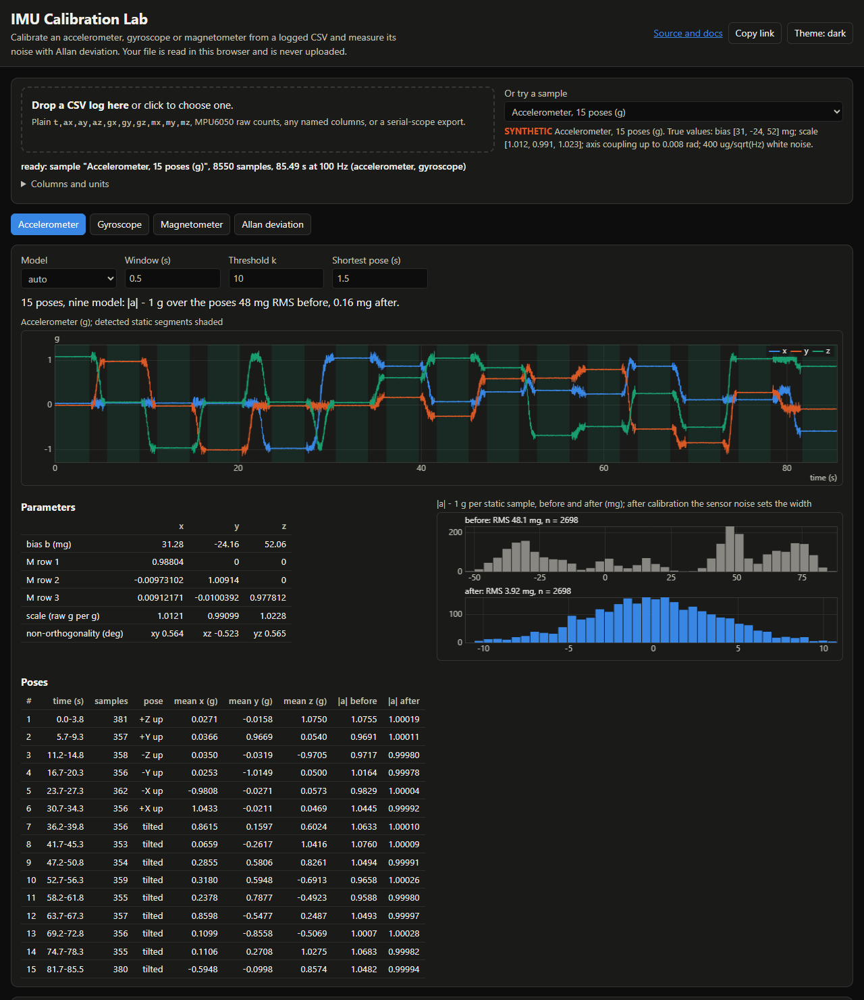
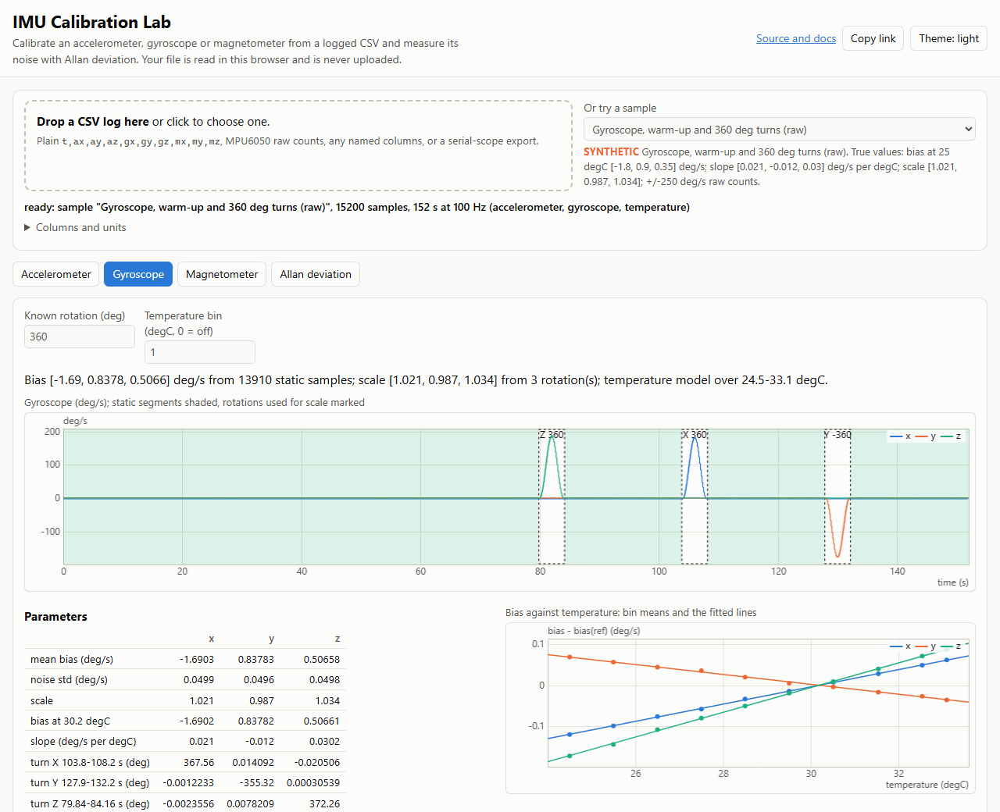
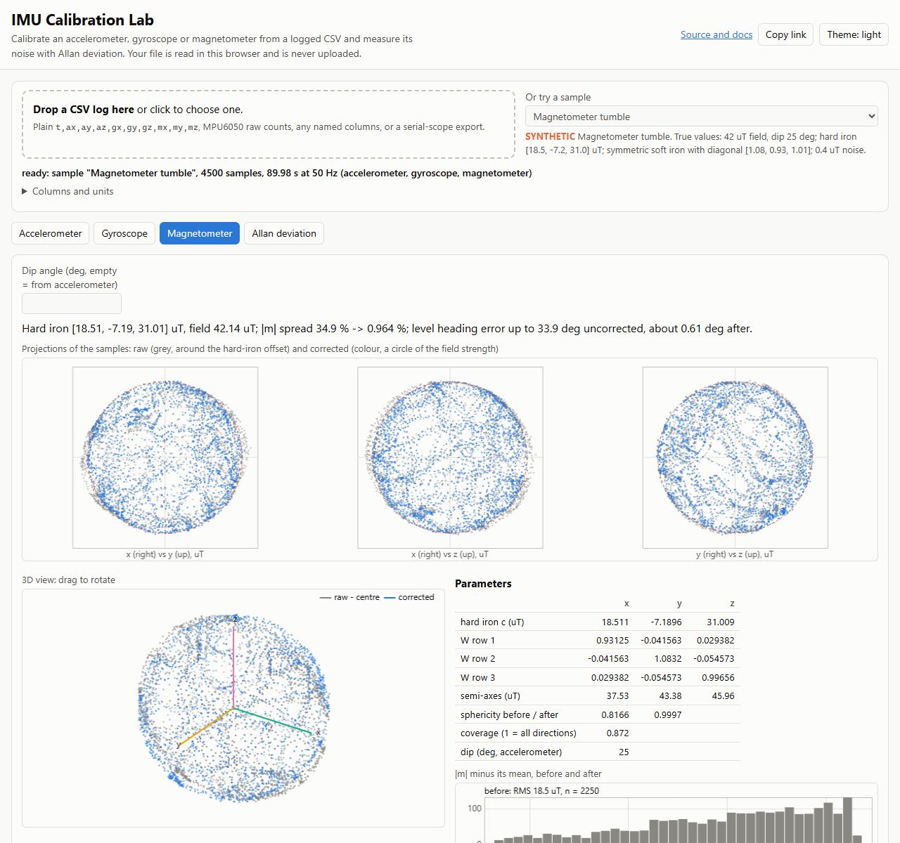
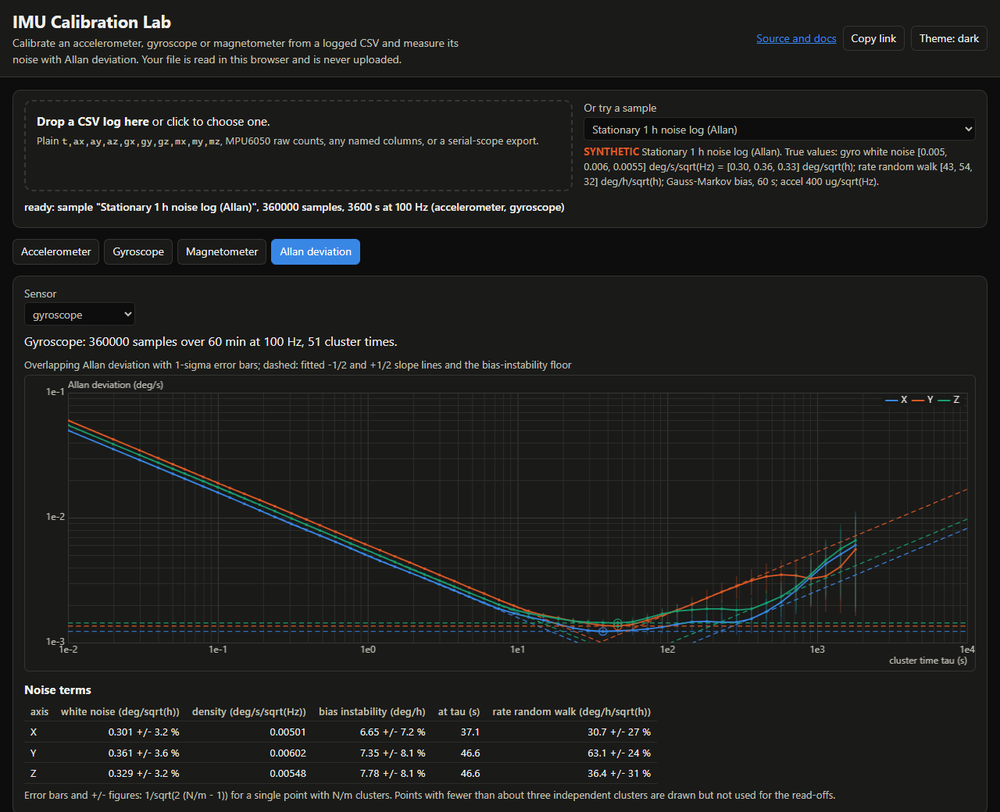

# IMU Calibration Lab

[](https://github.com/projectbin07-stack/imu-calibration-lab/actions/workflows/ci.yml)
[](LICENSE)

Calibrate an accelerometer, gyroscope and magnetometer from a logged CSV,
and measure the sensor's noise with Allan deviation, in the browser or from
the command line. Built with the MPU6050 in mind; works with any 3-axis
sensor whose readings you can log.

**Live demo: https://projectbin07-stack.github.io/imu-calibration-lab/**

Your file is read inside the browser and is never uploaded: the page makes
no network requests after loading its own files.

> **All bundled results come from synthetic data.** The samples, the
> examples, the numbers below and the screenshots are generated by
> `src/core/synth.js` with known biases, scales, misalignment, hard and soft
> iron and noise, so that the recovered values can be checked against the
> truth. **Nothing here has been validated on a physical sensor yet.** Check
> the residuals for your own log before using the numbers.



| Gyroscope: bias, temperature model, scale from 360 deg turns                                                                                     | Magnetometer: projections and 3D view before and after                                                                                                  |
| ------------------------------------------------------------------------------------------------------------------------------------------------ | ------------------------------------------------------------------------------------------------------------------------------------------------------- |
|  |  |



## Why

A cheap IMU on a robot reads 1.05 g lying flat, drifts a degree a minute
when it should be still, and its compass points 30 deg off next to the
motors. The fixes are well known (multi-position accelerometer calibration,
gyroscope bias and scale, ellipsoid fitting for the magnetometer, Allan
variance for the noise model of a Kalman filter), but they usually live in
MATLAB scripts or papers. This tool does them on a CSV you log with your own
firmware, shows whether the result is any good (residuals before and after,
fit conditioning, sphere coverage, confidence of each read-off), and gives
you constants to paste into the firmware.

## Features

- **Import**: plain `t,ax,ay,az,gx,gy,gz,mx,my,mz`, headerless files,
  arbitrary column names (mapped automatically, or by hand in the column
  mapper), Arduino MPU6050 names (`AcX`, `Tmp`, `GyX`...), and
  [serial-scope](https://github.com/projectbin07-stack/serial-scope) CSV
  exports (`host_time,device_time,source,...`) and snapshots
  (`channel,time,value`). Comma, semicolon or tab; BOM, CRLF, comments and
  quoted fields; errors give the line number.
- **Units**: MPU6050 raw counts at every full-scale range (+/-2..16 g,
  +/-250..2000 deg/s), g, m/s^2, deg/s, rad/s, uT, nT, mG, gauss, raw
  magnetometer counts, MPU6050 raw temperature; guessed from the magnitudes,
  changeable.
- **Static-segment detection** from the moving variance, with an automatic
  threshold.
- **Accelerometer**: six-position bias and scale; twelve-parameter least
  squares on axis-aligned poses; nine-parameter Levenberg-Marquardt fit on
  |a| = 1 g over any poses. Pose list, residuals before and after, scale
  factors and axis non-orthogonality.
- **Gyroscope**: bias from static data, temperature-binned linear bias model
  when the log has a temperature column, scale factors from known-angle
  turns.
- **Magnetometer**: Li-Griffiths ellipsoid fit, hard-iron offset, soft-iron
  matrix, sphericity and magnitude spread before and after, sphere coverage,
  heading-error estimate with the dip angle taken from the accelerometer.
- **Allan deviation**: overlapping estimator on log-spaced cluster times,
  read-off of white noise (angle/velocity random walk), bias instability and
  rate random walk with fitted slope lines and confidence.
- **Export**: JSON (one file per sensor, or the combined
  `{ generator, source, accel, gyro, mag }` file from the page or from
  `combine`), and a C/C++ header with const structs, apply functions
  and an Arduino example. CI compiles it as C99 and C++11 with
  `-Wall -Wextra -Werror -pedantic` and checks the output against the
  JavaScript results.
- **App**: drag and drop, column mapper, time series with static segments,
  pose table, residual histograms, magnetometer projections and a
  rotatable 3D view (no libraries), Allan plot, temperature plot, five
  synthetic samples, shareable settings in the URL, light/dark, phone
  layout. No external assets, CDNs or network calls.
- **CLI**: `accel`, `gyro`, `mag`, `allan`, `synth`; text, JSON or C
  output; deterministic.

## Quick start

In the browser: open the [live demo](https://projectbin07-stack.github.io/imu-calibration-lab/),
pick a sample or drop your CSV, and switch between the tabs.

From the command line (Node 22 or newer, no dependencies at run time):

```bash
git clone https://github.com/projectbin07-stack/imu-calibration-lab.git
cd imu-calibration-lab
node bin/imu-calibration-lab.js accel examples/accel-15pose.csv
```

Or `npm link` once and use `imu-calibration-lab` directly.

## Capturing data with an MPU6050

A minimal Arduino logger (wiring: VCC, GND, SDA, SCL; AD0 low for address
0x68). It sets +/-2 g, +/-250 deg/s and the digital low-pass filter to about
20 Hz, and prints raw counts at 100 Hz in a format the importer reads
directly. It has not been run on hardware as part of this project.

```cpp
#include <Wire.h>
const uint8_t MPU = 0x68;

void writeReg(uint8_t reg, uint8_t value) {
  Wire.beginTransmission(MPU); Wire.write(reg); Wire.write(value); Wire.endTransmission();
}

void setup() {
  Serial.begin(115200);
  Wire.begin();
  Wire.setClock(400000);
  writeReg(0x6B, 0x00);  // PWR_MGMT_1: wake up
  writeReg(0x1A, 0x04);  // CONFIG: DLPF_CFG = 4 (accel 21 Hz, gyro 20 Hz)
  writeReg(0x1B, 0x00);  // GYRO_CONFIG: +/-250 deg/s
  writeReg(0x1C, 0x00);  // ACCEL_CONFIG: +/-2 g
  Serial.println("t_ms,AcX,AcY,AcZ,Tmp,GyX,GyY,GyZ");
}

void loop() {
  static uint32_t next = micros();
  if ((int32_t)(micros() - next) < 0) return;
  next += 10000;  // 100 Hz
  Wire.beginTransmission(MPU); Wire.write(0x3B); Wire.endTransmission(false);
  Wire.requestFrom(MPU, (uint8_t)14);
  Serial.print(millis());
  for (int i = 0; i < 7; i++) {
    uint8_t hi = Wire.read();
    uint8_t lo = Wire.read();
    Serial.print(','); Serial.print((int16_t)((hi << 8) | lo));
  }
  Serial.println();
}
```

Log it with serial-scope (`serial-scope monitor COM5 -b 115200 --decode csv
--csv imu.csv`; the `t_ms` column becomes its device clock) or any serial
logger, and keep the full-scale settings in mind: the importer guesses the
accelerometer range from |a| at rest, but set it in "Columns and units" (or
`--accel-range`, `--gyro-range`) if you changed it.

**Accelerometer (multi-position).** Put the board in a box with flat faces
or against a square block. Hold each pose perfectly still for 4-5 s on a
firm table, then turn it to the next. For the six-position and
twelve-parameter methods use the six faces (+X, -X, +Y, -Y, +Z, -Z up),
aligned as well as you can: the twelve-parameter result is only as good as
that alignment. For the nine-parameter fit add at least 3-4 tilted poses
(edges and corners), 12-20 poses in total, spread over all directions; it
does not need any alignment. Avoid touching the board during a hold.

**Gyroscope.** Leave the board still from power-on for a few minutes so the
temperature model sees the warm-up (MPU6050 die temperature is logged as
`Tmp`). Then, for each axis, hold still for 10 s, turn exactly 360 deg about
that axis (a box against a wall edge or a turntable; the turn must end where
it started) and hold still again. The known angle can be changed for
other fixtures (`--angle`).

**Magnetometer.** Log the magnetometer with its own columns `mx,my,mz`
(an MPU6050 has none; an MPU9250's AK8963, an HMC5883L or a QMC5883L does).
Mount it where it will be used, with the motors and battery in place, away
from steel furniture, and turn it slowly through every orientation for
60-90 s (figure-eights about all axes) until the 3D view shows a full
shell. Coverage below 0.3 gets a warning.

**Allan variance.** Leave the board completely still on a vibration-free
surface at a stable temperature, after warm-up, and log at a fixed rate
well above the DLPF bandwidth. Bias instability needs a log several times
longer than the cluster time where it appears (tens to hundreds of seconds
for MEMS parts): at least 1 hour; rate random walk needs several hours.
100 Hz for 1 hour is 360 000 rows (about 15-25 MB of CSV), which the
browser handles.

## Methods

Full equations, choices and references: [docs/methods.md](docs/methods.md).

| Method           | Model and estimate                                                                                                                   | Limits                                                                                                     |
| ---------------- | ------------------------------------------------------------------------------------------------------------------------------------ | ---------------------------------------------------------------------------------------------------------- |
| Static detection | sum of per-axis moving variances (0.5 s) below `k` (10) x its 20th percentile, gyroscope too; runs >= 1.5 s                          | needs the log to be mostly static; a constant-rate turn about gravity looks static to the accelerometer    |
| Six-position     | `b_i = (u_i + d_i) / 2`, `s_i = (u_i - d_i) / 2` from the +1 g and -1 g poses                                                        | no misalignment; assumes perfectly aligned poses                                                           |
| Twelve-parameter | `r_k = M a_k + c` by linear least squares on poses within 10 deg of an axis, `b = -M^-1 c`                                           | body frame = the frame you aligned to; 2 deg placement errors show up in `M`                               |
| Nine-parameter   | minimise `sum (norm(M (a_k - b)) - 1)^2`, `M` lower triangular, Levenberg-Marquardt                                                  | needs >= 9 well-spread poses; frame rotation not observable                                                |
| Gyroscope bias   | mean of static samples, or `b(T) = b0 + k (T - T_ref)` fitted to 1 degC bins                                                         | linear in temperature, logged range only                                                                   |
| Gyroscope scale  | `s_i = integral(w_i - b_i) dt / angle` over the largest single-axis turn                                                             | angle error of the turn goes straight into `s`; no cross-axis terms                                        |
| Magnetometer     | Li-Griffiths fit of `(m - c)^T A (m - c) = 1`; `W = R sqrtm(A)`, `m_cal = W (m - c)`                                                 | symmetric `W` (rotation not observable); axis ratios below 0.5 not guaranteed; needs full coverage         |
| Allan deviation  | overlapping AVAR; `N` from the -1/2 line at 1 s, `B = sigma_min / 0.664`, `K` from the +1/2 line at 3 s; error `1/sqrt(2 (N/m - 1))` | assumes uniform sampling and stationarity; `B` reads high on a narrow floor; no quantisation or ramp terms |

MPU6050 scaling (register map RM-MPU-6000A-00): 16384, 8192, 4096, 2048 LSB/g
at +/-2, 4, 8, 16 g; 131, 65.5, 32.8, 16.4 LSB/(deg/s) at +/-250, 500,
1000, 2000 deg/s; `T = TEMP_OUT / 340 + 36.53` degC.

## Command line

```text
$ imu-calibration-lab --help
imu-calibration-lab 0.2.0: IMU calibration and noise analysis from logged data

Usage:
  imu-calibration-lab accel <file.csv> [options]   accelerometer bias, scale, misalignment
  imu-calibration-lab gyro <file.csv> [options]    gyroscope bias, temperature model, scale
  imu-calibration-lab mag <file.csv> [options]     magnetometer hard and soft iron
  imu-calibration-lab allan <file.csv> [options]   Allan deviation and noise terms
  imu-calibration-lab synth <kind> [options]       write a synthetic log (accel,
                                                   accel-axis, gyro, mag, noise)
  imu-calibration-lab combine <result.json>...     merge accel, gyro and mag --json
                                                   results into the page's export file
  imu-calibration-lab --help | --version

Output:
  --json                 print JSON instead of text
  --c                    print a C/C++ header (accel, gyro, mag)

Import (columns and units are detected; these override):
  --map <spec>           e.g. "t=millis,ax=AcX,ay=AcY,az=AcZ"; "temp=-" drops one
  --time-units s|ms|us
  --rate <Hz>            sample rate when the file has no time column
  --accel-units g|mps2|lsb    --accel-range 2|4|8|16   (MPU6050 full scale)
  --gyro-units dps|rads|lsb   --gyro-range 250|500|1000|2000
  --mag-units uT|nT|mG|gauss|raw    --temp-units C|mpu6050

Static detection (accel, gyro):
  --window <s>           moving-variance window (default 0.5)
  --k <x>                threshold = k x 20th percentile of the variance (default 10)
  --threshold <g^2>      fixed accelerometer variance threshold instead
  --min-static <s>       shortest static segment (default 1.5)

accel:  --model auto|six|twelve|nine (default auto)
gyro:   --angle <deg> known rotation angle (default 360)
        --rotation <t0,t1,axis>  use this window (s) and axis (x|y|z) for the scale
        --temp-bin <degC> (default 1; 0 disables the temperature model)
        --all-static  use every sample for the bias
mag:    --dip <deg>   inclination for the heading estimate (default: from the
                      accelerometer, else 45)
allan:  --sensor gyro|accel   --per-decade <n> (default 10)
synth:  --seed <n>  --raw (MPU6050 counts, t in ms)  --seconds <s> (noise)
        --out <file.csv> (default: standard output)
combine: --source <name>  "source" field (default: the result file names)
        --out <file.json> (default: standard output)

Everything runs locally; no file is uploaded anywhere.
```

The outputs below were captured on the development machine (Windows 11,
Node 25) from the synthetic files in `examples/` (regenerate them with
`node scripts/make-examples.js`).

**Accelerometer, 15 poses.** True values: bias [31, -24, 52] mg, scale
[1.012, 0.991, 1.023], coupling up to 0.008 rad.

```text
$ imu-calibration-lab accel examples/accel-15pose.csv
examples/accel-15pose.csv: 8550 samples, 85.49 s at 100 Hz; accel g, gyro dps
static segments: 15 (threshold 0.00044 g^2, window 51 samples) -> 15 poses
pose  time (s)        samples  label    mean (g)                          |a| before  after
   1  0.0-3.8             381  +Z up      0.0271  -0.0158   1.0750    1.0755    1.00019
   2  5.7-9.3             357  +Y up      0.0366   0.9669   0.0540    0.9691    1.00011
   3  11.2-14.8           358  -Z up      0.0350  -0.0319  -0.9705    0.9717    0.99980
   4  16.7-20.3           356  -Y up      0.0253  -1.0149   0.0500    1.0164    0.99978
   5  23.7-27.3           362  -X up     -0.9808  -0.0271   0.0573    0.9829    1.00004
   6  30.7-34.3           356  +X up      1.0433  -0.0211   0.0469    1.0445    0.99992
   7  36.2-39.8           356  tilted     0.8615   0.1597   0.6024    1.0633    1.00010
   8  41.7-45.3           353  tilted     0.0659  -0.2617   1.0416    1.0760    1.00009
   9  47.2-50.8           354  tilted     0.2855   0.5806   0.8261    1.0494    0.99991
  10  52.7-56.3           359  tilted     0.3180   0.5948  -0.6913    0.9658    1.00026
  11  58.2-61.8           355  tilted     0.2378   0.7877  -0.4923    0.9588    0.99980
  12  63.7-67.3           357  tilted     0.8598  -0.5477   0.2487    1.0493    0.99997
  13  69.2-72.8           356  tilted     0.1099  -0.8558  -0.5069    1.0007    1.00028
  14  74.7-78.3           355  tilted     0.1106   0.2708   1.0275    1.0683    0.99982
  15  81.7-85.5           380  tilted    -0.5948  -0.0998   0.8574    1.0482    0.99994
model: nine (Levenberg-Marquardt, 5 iterations, condition 44.9)
bias b (g):            [0.031284, -0.02416, 0.052064]
matrix M:              [0.98804, 0, 0]
                       [-0.009731, 1.0091, 0]
                       [0.0091217, -0.010039, 0.97781]
scale (raw g per g):   [1.0121, 0.99099, 1.0228]
non-orthogonality:     xy 0.564 deg, xz -0.523 deg, yz 0.565 deg
|a|-1 over poses:      RMS 48 mg -> 0.16 mg, max 76 mg -> 0.276 mg
```

**Six-position on MPU6050 raw counts** (range detected from |a| at rest):

```text
$ imu-calibration-lab accel examples/accel-6pose-mpu6050-raw.csv --model six
examples/accel-6pose-mpu6050-raw.csv: 3450 samples, 34.49 s at 100 Hz; accel lsb (+/-2 g), gyro lsb (+/-250 deg/s)
...
model: six
bias b (g):            [0.031192, -0.024002, 0.052266]
matrix M:              [0.98812, 0, 0]
                       [0, 1.0092, 0]
                       [0, 0, 0.97774]
scale (raw g per g):   [1.012, 0.99089, 1.0228]
non-orthogonality:     xy 0 deg, xz 0 deg, yz 0 deg
|a|-1 over poses:      RMS 40.8 mg -> 0.0275 mg, max 75.5 mg -> 0.0424 mg
```

(Six poses determine the six parameters, so the residual at those same
poses is small by construction and says little about misalignment. Log
more poses to check it.)

**Gyroscope.** True values: bias at 25 degC [-1.8, 0.9, 0.35] deg/s, slope
[0.021, -0.012, 0.03] deg/s per degC, scale [1.021, 0.987, 1.034].

```text
$ imu-calibration-lab gyro examples/gyro-turns-mpu6050-raw.csv
examples/gyro-turns-mpu6050-raw.csv: 15200 samples, 151.99 s at 100 Hz; accel lsb (+/-2 g), gyro lsb (+/-250 deg/s), temp mpu6050
static samples: 13910 in 4 segment(s)
bias (deg/s):          [-1.6903, 0.83783, 0.50658]
noise std (deg/s):     [0.0499, 0.0496, 0.0498]
temperature model:     bias(T) = b + k (T - 30.2 degC), 10 bins from 24.5 to 33.1 degC
  b (deg/s):           [-1.6902, 0.83782, 0.50661]
  k (deg/s per degC):  [0.021, -0.012, 0.0302]
rotation X: 103.8-108.2 s, integrated [367.56, 0.014092, -0.020506] deg vs 360 deg -> scale 1.021
rotation Y: 127.9-132.2 s, integrated [-0.0012233, -355.32, 0.00030539] deg vs -360 deg -> scale 0.987
rotation Z: 79.84-84.16 s, integrated [-0.0023556, 0.0078209, 372.26] deg vs 360 deg -> scale 1.034
scale:                 [1.021, 0.987, 1.034]
```

(`b` is at the log's mean temperature, 30.2 degC; at 25 degC the model gives
[-1.80, 0.90, 0.35] deg/s.)

**Magnetometer.** True values: hard iron [18.5, -7.2, 31.0] uT, 42 uT
field, dip 25 deg.

```text
$ imu-calibration-lab mag examples/mag-tumble.csv
examples/mag-tumble.csv: 4500 samples, 89.98 s at 50 Hz; accel g, gyro dps, mag uT
hard iron c:           [18.511, -7.1896, 31.009] uT
soft iron W:           [0.93125, -0.041563, 0.029382]
                       [-0.041563, 1.0832, -0.054573]
                       [0.029382, -0.054573, 0.99656]
field strength:        42.14 uT
semi-axes:             [37.53, 43.38, 45.96]
sphericity (min/max):  0.8166 -> 0.9997
|m| spread (std/mean): 34.9 % -> 0.964 %
coverage:              0.872 (1 = all directions)
heading error (level, dip 25 deg from accelerometer): up to 33.9 deg uncorrected, about 0.61 deg after
```

**Allan deviation** of a synthetic one-hour stationary log. True values:
white noise [0.30, 0.36, 0.33] deg/sqrt(h), rate random walk [43, 54, 32]
deg/h/sqrt(h), plus a Gauss-Markov bias with a 60 s correlation time.

```text
$ imu-calibration-lab synth noise --out noise.csv
wrote noise.csv: 360000 samples
$ imu-calibration-lab allan noise.csv
noise.csv: 360000 samples, 3600 s at 100 Hz; accel g, gyro dps
Allan deviation (gyro), 51 cluster times from 0.01 s to 1800 s
axis  white noise (deg/sqrt(h))  bias instability (deg/h)  rate random walk (deg/h/sqrt(h))
X     0.301 +/- 3.2 %           6.65 +/- 7.2 % at 37.1 s                30.7 +/- 27 %
Y     0.361 +/- 3.6 %           7.35 +/- 8.1 % at 46.6 s                63.1 +/- 24 %
Z     0.329 +/- 3.2 %           7.78 +/- 8.1 % at 46.6 s                36.4 +/- 31 %
Confidence: 1-sigma error of a single Allan deviation point, 1/sqrt(2 (N/m - 1)).
```

The white noise comes back within 1 %; the rate random walk, read from the
last few cluster times of a one-hour log, is off by up to 29 % (X) and is
within about one stated standard error on each axis. That is what one hour
of data supports.

**C header** (excerpt of `--c`; the full file also has the Arduino example):

```c
// Accelerometer, model "nine": a_cal = M (a - b), a in g.
// Pose residual |a|-1 g: RMS 48 mg before, 0.16 mg after.
typedef struct {
  float bias[3];       // g
  float matrix[3][3];  // scale and misalignment
} imu_accel_cal_t;

static const imu_accel_cal_t IMU_ACCEL_CAL = {
  {0.03128424f, -0.02416014f, 0.05206445f},
  {
    {0.9880404f, 0.0f, 0.0f},
    {-0.00973102f, 1.009143f, 0.0f},
    {0.009121706f, -0.01003916f, 0.9778118f}
  }
};

static inline void imu_accel_apply(const imu_accel_cal_t *c, const float in[3], float out[3]) {
  const float u[3] = {in[0] - c->bias[0], in[1] - c->bias[1], in[2] - c->bias[2]};
  for (int i = 0; i < 3; i++)
    out[i] = c->matrix[i][0] * u[0] + c->matrix[i][1] * u[1] + c->matrix[i][2] * u[2];
}
```

**Combined calibration file.** The page's JSON export is one file,
`{ generator, source, accel, gyro, mag }`. `combine` writes the same file
from `--json` results, through the same function in `src/core/export.js`,
so the bytes match the page's export for the same logs, settings and source name.
A sensor that is not given is `null`, as on the page for a log without
that sensor.

```text
$ imu-calibration-lab accel examples/accel-15pose.csv --json > accel.json
$ imu-calibration-lab gyro examples/gyro-turns-mpu6050-raw.csv --json > gyro.json
$ imu-calibration-lab mag examples/mag-tumble.csv --json > mag.json
$ imu-calibration-lab combine accel.json gyro.json mag.json --source "bench IMU, 2026-11-24" --out imu-calibration.json
wrote imu-calibration.json: accel, gyro, mag
$ head -9 imu-calibration.json
{
  "generator": "imu-calibration-lab 0.2.0",
  "source": "bench IMU, 2026-11-24",
  "accel": {
    "kind": "accel",
    "model": "nine",
    "units": "g",
    "apply": "a_cal = M (a_raw - b)",
    "bias": [
```

Each result must be the `--json` output of `accel`, `gyro` or `mag`, and
each kind may appear once; anything else is a data error (exit code 1):

```text
$ imu-calibration-lab combine accel.json accel.json
error: accel.json: a second accel result (the first is accel.json)
$ imu-calibration-lab combine gyro.json allan.json
error: allan.json: kind "allan" is not part of the combined file (accel, gyro or mag)
```

`--json` prints the same parameters with the poses, residuals, rotations,
temperature bins or Allan curves. Exit codes: 0 success, 1 data error (with
the line number for CSV problems), 2 usage error.

## Architecture

```
index.html, styles.css        static page, no build step
src/core/  (DOM-free, deterministic, tested under Node)
  units.js      unit factors, MPU6050 register scaling
  csv.js        CSV parsing, serial-scope formats, column mapping, unit guesses, dataset
  load.js       text -> table -> mapping -> units -> dataset
  linalg.js     small dense linear algebra (solve, Cholesky, Jacobi eigen, sqrtm)
  lm.js         Levenberg-Marquardt
  static.js     moving variance, static-segment detection
  accel.js      poses, six / twelve / nine-parameter calibration, residuals
  gyro.js       bias, temperature model, known-angle scale
  mag.js        Li-Griffiths ellipsoid fit, hard/soft iron, metrics, heading error
  allan.js      overlapping Allan deviation, slope read-off, confidence
  synth.js      seeded synthetic logs with known parameters
  samples.js    the browser's sample datasets
  export.js     JSON summaries, C/C++ header
  rng.js        mulberry32 + Box-Muller
src/ui/
  state.js      URL <-> settings (tested)
  draw.js       canvas charts and the 3D view
  app.js        page wiring
src/cli.js, bin/imu-calibration-lab.js   command-line interface
scripts/make-examples.js                 regenerates examples/*.csv
scripts/check-c-export.js                compiles and checks the C/C++ export (gcc, g++)
```

The browser and the CLI run exactly the same `src/core` code.

## Tests

```bash
npm ci
npm run check        # Prettier, tsc --checkJs --strict, node:test with coverage thresholds
```

On the development machine (Windows 11, Node 25) `npm run coverage` reports
65 tests, 65 passing, with 98.91 % line, 94.82 % branch and 97.39 % function
coverage over the measured files (`src/ui/app.js` and `src/ui/draw.js` are
excluded; CI loads the page in headless Chrome instead).

What the tests check, all on synthetic data with known truth:

- **Accelerometer**: over 5 seeds, the nine-parameter fit recovers the bias
  within 1 mg, `M D` is a rotation within 2e-3 and the scale factors are
  within 1e-3; the twelve-parameter and six-position fits on the six axis
  poses recover `M` (or bias and scale) within 1e-3; noise-free data are
  recovered to 1e-6; a 2 deg placement error degrades the twelve-parameter
  fit (> 5e-3) but not the nine-parameter one; all 15 holds are detected.
- **Gyroscope**: over 5 seeds, bias at 25 degC within 0.01 deg/s,
  temperature slope within 1e-3 deg/s per degC, scale within 2e-3, noise
  standard deviation 0.05 +/- 0.01 deg/s; a wrong known angle is flagged.
- **Magnetometer**: a perfect sphere gives the centre and an identity
  soft-iron matrix to 1e-9; a noise-free ellipsoid gives `A = (S S^T)^-1`
  to 1e-9; over 5 seeds the hard iron is within 0.2 uT and `W S` is a
  multiple of the identity within 1 %, the dip is within 1.5 deg; heading
  error matches the closed forms `asin(e / Bh)` = 30 deg and 19.47 deg for
  a 2:1 axis ratio.
- **Allan deviation**: a hand-computed 4-sample case; pure white noise
  follows the -1/2 slope within 0.02 and recovers the noise density within
  3 % (5 seeds); `N`, `B` and `K` read off an analytic curve; rate random
  walk recovered within 35 % from a 2 h log; unit conversions.
- **Import**: every serial-scope format, Arduino names, raw MPU6050 counts,
  BOM/CRLF/semicolons/quotes, line-numbered errors, unit guesses, MPU6050
  scaling at every range and the temperature formula.
- **Export, CLI and determinism**: same seed, same data and the same CLI
  output; JSON shape; C header structure; exit codes; `combine` on the
  example logs gives the same bytes as the page's export path, and rejects
  Allan results, files without a kind, duplicate kinds, invalid JSON and
  unreadable files. CI also compiles the
  header with gcc and g++ and compares the apply functions with JavaScript.

## Known limitations

- **Not validated on hardware.** No log from a physical MPU6050 or
  magnetometer has been calibrated and compared with an independent
  reference. The Arduino logger above has not been run as part of this
  project.
- Accelerometer: linear model with 1 g as the reference (local gravity
  differs by up to about 0.5 %); no temperature dependence.
- Gyroscope: scale accuracy is limited by how exactly the turn is 360 deg;
  no cross-axis sensitivity or g-sensitivity; linear temperature model over
  the logged range only.
- Magnetometer: the soft-iron matrix is symmetric (the rotation between
  magnetometer and body frame is not estimated, so align it with the
  accelerometer separately); strongly distorted fields (axis ratio < 0.5)
  are outside the Li-Griffiths guarantee; the heading error after
  calibration is an estimate from the residuals.
- Allan deviation assumes uniform sampling at the median rate (gaps are
  reported, not filled), a stationary sensor and temperature; confidence is
  the simple single-point formula, not chi-square intervals; quantisation
  noise and rate ramp are not fitted.
- Static detection with the automatic threshold assumes most of the log is
  static.
- Very large files (many hours at high rates) are limited by browser memory;
  the CLI handles them better.

## Roadmap

- Validate against real MPU6050 and magnetometer logs with a reference
  (rate table, precision level, known heading), and publish those logs.
- Gyroscope calibration without a known angle, using the accelerometer
  gravity direction before and after each turn (Tedaldi et al. 2014).
- Magnetometer-to-accelerometer alignment.
- Chi-square confidence intervals for Allan deviation (equivalent degrees
  of freedom).
- Temperature-compensated accelerometer bias.

## License

MIT, see [LICENSE](LICENSE).
